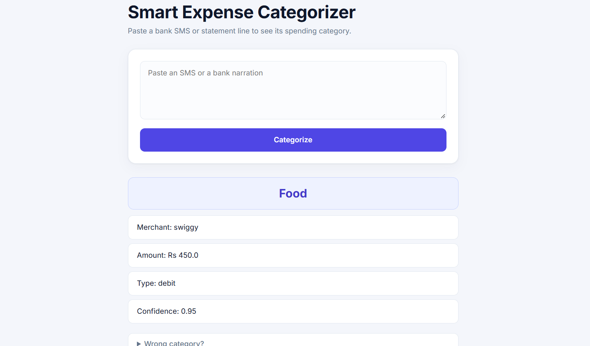

# Smart Expense Categorizer

A small machine-learning app that reads a bank SMS or statement line, pulls out the merchant, amount and debit/credit, and predicts a spending category (Food, Transport, Bills, Shopping, Entertainment, Health). When the model isn't confident it says **"Not sure"** instead of guessing, and you can correct it.

## How it works

pasted SMS / narration -> parser (regex) -> merchant text -> TF-IDF + Logistic Regression -> category (or "Not sure")

Corrections saved from the app go to `data/corrections.csv` and are meant to be future training data.

- **Parser** (`src/parser.py`): regex rules strip bank noise (reference numbers, card prefixes, city names) and extract merchant, amount and debit/credit. Messages that don't look like transactions return "No merchant found".
- **Model** (`src/train.py`): TF-IDF over character n-grams (3-5) + Logistic Regression (scikit-learn). Character n-grams help with merchants the model has never seen.
- **Confidence check** (`src/predict.py`): if the top class probability is below 0.5, the app answers "Not sure".
- **App** (`src/app.py`): Flask web page with a correction form that saves your fixes locally.

## Results (honest numbers)

- Training data is **generated** (`src/make_data.py`: 6 categories, about 700 rows, Indian merchants and UPI/SMS-style templates), so the near-perfect score on its own test split means little.
- On a **hand-labeled test of 13 real bank-statement merchants**: 11/13 correct without the confidence check. With the 0.5 cutoff, the 9 answered were all correct and 4 were "Not sure".
- On a **harder set of 20 merchants it had never seen**: 11/20 correct without the cutoff. With the cutoff, the 10 answered were all correct and 10 were "Not sure".
- These test sets are small, so treat them as indications, not benchmarks.

## Run it

    python -m venv .venv
    .venv\Scripts\Activate.ps1
    python -m pip install pandas numpy scikit-learn matplotlib joblib flask
    python src/make_data.py
    python src/train.py
    python src/app.py

Then open http://127.0.0.1:5000

## Project structure

- `src/`: make_data.py, train.py, predict.py, parser.py, textutils.py, app.py
- `templates/`: index.html
- `static/`: style.css
- `data/`: transactions.csv (generated), real_test.csv, corrections.csv (local only)
- `models/`: saved vectorizer and model

## Limitations

- The parser covers a handful of SMS and statement formats; other banks may need new patterns.
- Transfers to people, ATM cash and groceries have no category yet.
- Merchants with no recognisable word often come out as "Not sure".

## Privacy

Only the cleaned merchant text and your chosen category are saved. Account numbers, phone numbers and full SMS text are never stored. `data/corrections.csv` is git-ignored.

## Next steps

- Retrain with real corrections collected from the app.
- Add categories for groceries and transfers.
- Upload a statement CSV and categorize all rows at once.